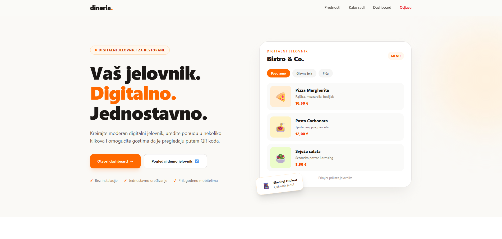
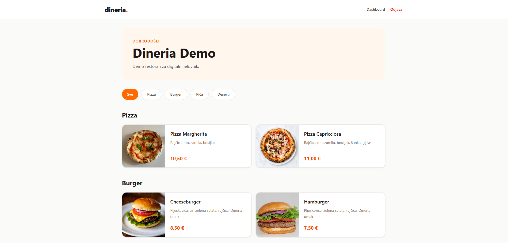
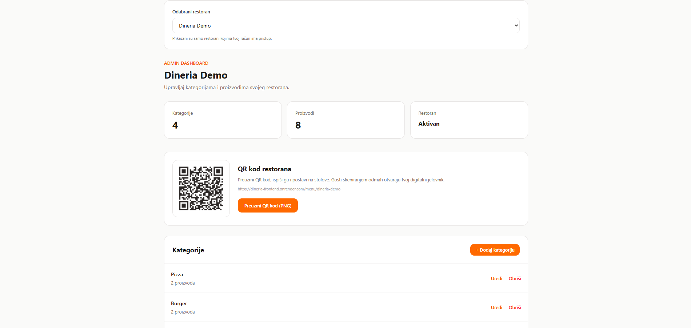
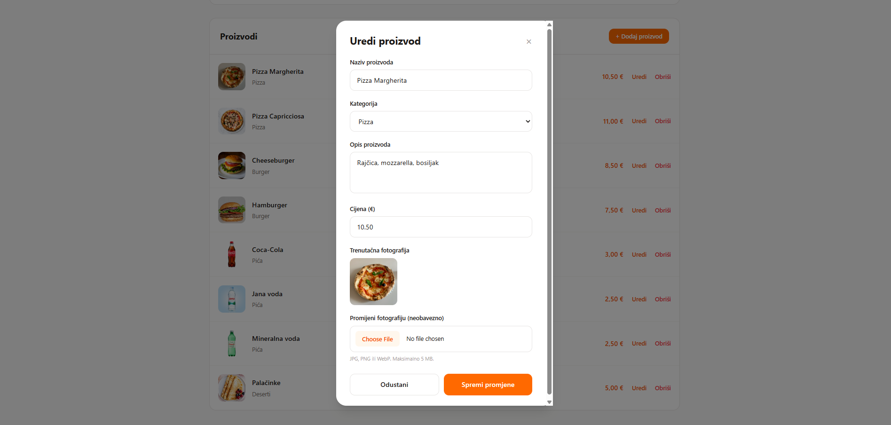
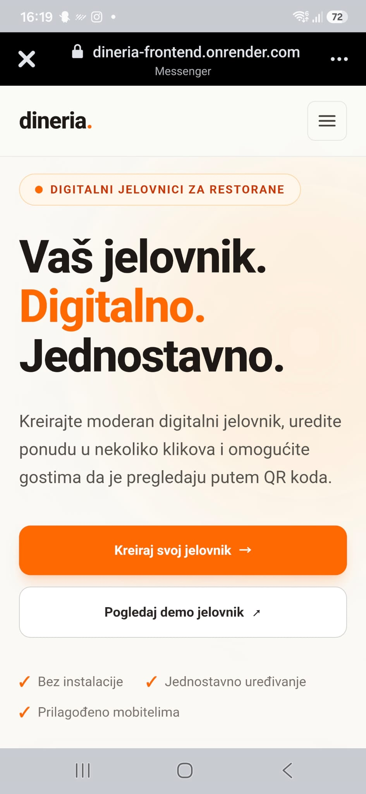
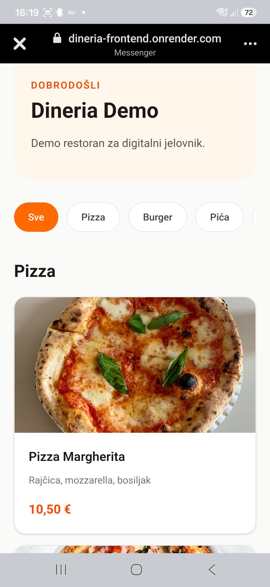
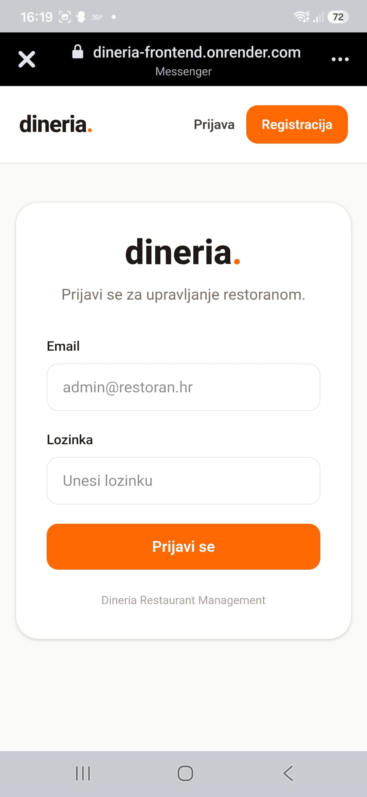
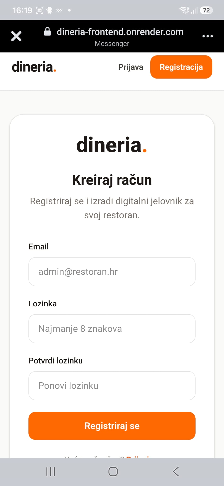

# Dineria

**A modern QR-based digital menu management platform for restaurants.**

Dineria is a full-stack web application designed to help restaurants create, manage, and share their digital menus through QR codes.

The platform provides restaurant owners with an intuitive dashboard for managing their menus, while customers can easily browse them on any device without downloading an app.

**Language:** The application interface is currently available in Croatian, as Dineria was initially developed for the Croatian restaurant market.

**Live Demo:** [Dineria](https://dineria-frontend.onrender.com/)

**Backend API:** [FastAPI](https://dineria-backend.onrender.com/)

## Features

- **User Authentication** – Secure registration and login for restaurant administrators.
- **Restaurant Management** – Create and manage multiple restaurants from a single account.
- **Menu Management** – Add, edit, and delete menu categories and products.
- **Image Uploads** – Upload product images to enhance digital menus.
- **QR Code Generation** – Generate QR codes that link directly to each restaurant's public menu.
- **Responsive Design** – Optimized for desktop, tablet, and mobile devices.
- **Public Digital Menus** – Customers can browse restaurant menus without creating an account.

## Tech Stack

| Technology | Purpose |
|---|---|
| Vue 3 | Frontend framework |
| JavaScript | Frontend development |
| Python / FastAPI | Backend and REST API |
| PostgreSQL | Relational database |
| Supabase | Authentication, database, and file storage |
| Render | Application hosting and deployment |

## How It Works

1. Restaurant owners register and log in to their dashboard.
2. They create a restaurant and organize their menu into categories.
3. Products, descriptions, prices, and images can be added or updated at any time.
4. Each restaurant receives a QR code linking to its public digital menu.
5. Customers scan the QR code to access the latest menu directly from their smartphones.

## Project Goal

Dineria was developed to provide a simple and practical solution for digital restaurant menus, combining an easy-to-use management interface with a convenient browsing experience for customers.

The project demonstrates full-stack web development, REST API integration, user authentication, database management, and cloud deployment.

## Screenshots

### Desktop

**Homepage**

**Admin Dashboard**

**Digital Menu**

**Product Editing**

### Mobile

**Homepage**

**Digital Menu**

**Login**

**Registration**

